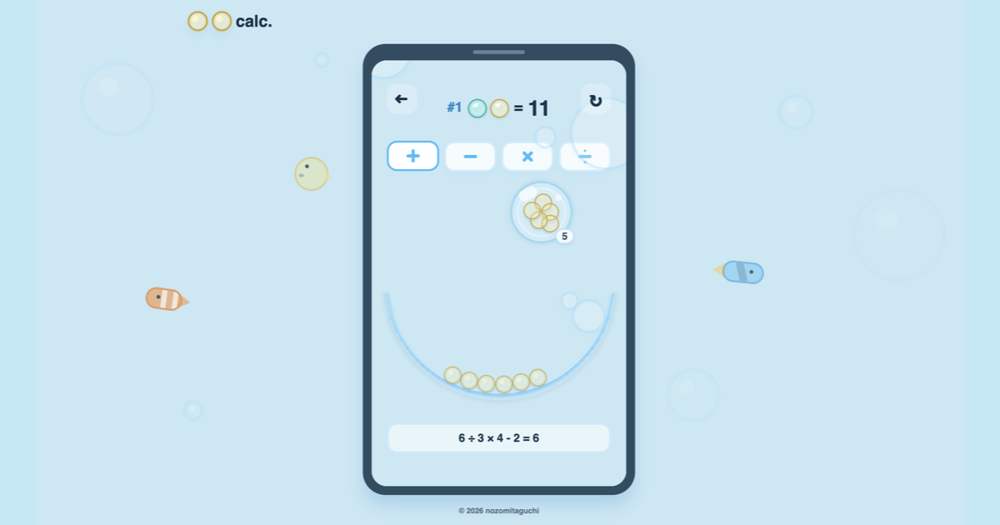

# まるまる電卓

**すうじをさわろう。**  
"まる"をさわって、動かして。式を見て、答えて。足し算から割り算、九九まで、数を見た目で感じる子ども向け計算あそびです。

[まるまる電卓をひらく](https://maru-maru-calc.github.io/maru-maru-calc/)



## まるまる電卓について

まるまる電卓は、答えだけを急がずに、数の変化をさわって発見するための計算あそびです。現在は、まるを動かして目標の数をつくる「まるまるモード」と、式を見て数字で答える「でんたくモード」で遊べます。

- まるをさわって、動かして、数を見た目で感じられます。
- 足し算、引き算、掛け算、割り算の4つのさわりかたで遊べます。
- でんたくモードでは、式を読んで答えたあとに、まるの動きで計算をたしかめられます。
- 九九は1の段から9の段まで、段ごとの練習とランダム練習に対応しています。
- まちがえた時も、まるの動きから何が起きたかを見つけられます。
- 親子であそぶなら、3歳ごろからを想定しています。
- Webで遊べるほか、将来的にアプリ版としての展開も見据えています。

## 遊び方

### まるまるモード

まると計算記号を組み合わせて、ステージごとの目標の数をつくります。足し算、引き算、掛け算、割り算、複数の記号を組み合わせた問題で遊べます。

### でんたくモード

画面に出た式を見て、数字キーで答えます。答えたあとに、まるが動いて計算の流れを見せます。九九、四則演算、複数の記号を使った問題に対応しています。

## 公開ページ

https://maru-maru-calc.github.io/maru-maru-calc/

## 開発

このプロジェクトは Expo Router / React Native Web で作っています。

```bash
npm install
npm run web
```

主なコマンド:

```bash
npm run typecheck
npm run test
npm run e2e
npm run export:web
```

## GitHub Pages

`main` ブランチへpushすると、GitHub ActionsでWeb版をエクスポートしてGitHub Pagesへデプロイします。

Web版はホーム画面に追加でき(`public/manifest.webmanifest`)、一度開けばオフラインでも遊べます。オフライン用のService Worker(`dist/sw.js`)は `scripts/service-worker.js` をもとに `npm run export:web` の最後で生成します。BGMは容量が大きいためオフライン保存の対象外で、オフライン時はBGMなしになります。

Web版は1ページ構成(SPA)なので、`npm run export:web` の最後に `index.html` を `game.html` / `play.html` / `404.html` としてコピーしています。これで `/game` と `/play` が「404 Not Found」ではなく通常のページとして配信されます。

SNSやSlackで共有された時の表示用に、タイトル、description、OGP/Twitter Card、favicon、apple-touch-iconを設定しています。

## YouTube 向けビルド(パズルだけ)

大人用パズル(`/puzzle`)だけを、YouTube のゲーム(Playables)に載せられる形で書き出せます。

```sh
npm run export:youtube
```

`dist-youtube/` にできるのがアップロード用の一式です(`dist-youtube-raw/` は途中の出力)。

- 入口は `src/youtube/entry.tsx` です。ルーターも学習アプリも入りません。どちらのアプリを作るかは `metro.config.js` が決めます
- セーブ・一時停止・音のオン/オフは YouTube の SDK に従います(`src/youtube/youtube-host.ts`)。ブラウザの保存領域は使いません
- `scripts/build-youtube.js` が、YouTube の決まり(SDK を最初に読む、パスは相対、ファイル名に使える文字、容量)を確かめ、破っていれば失敗します

## ライセンス

現時点ではライセンス未定です。無断での再配布や商用利用はしないでください。
